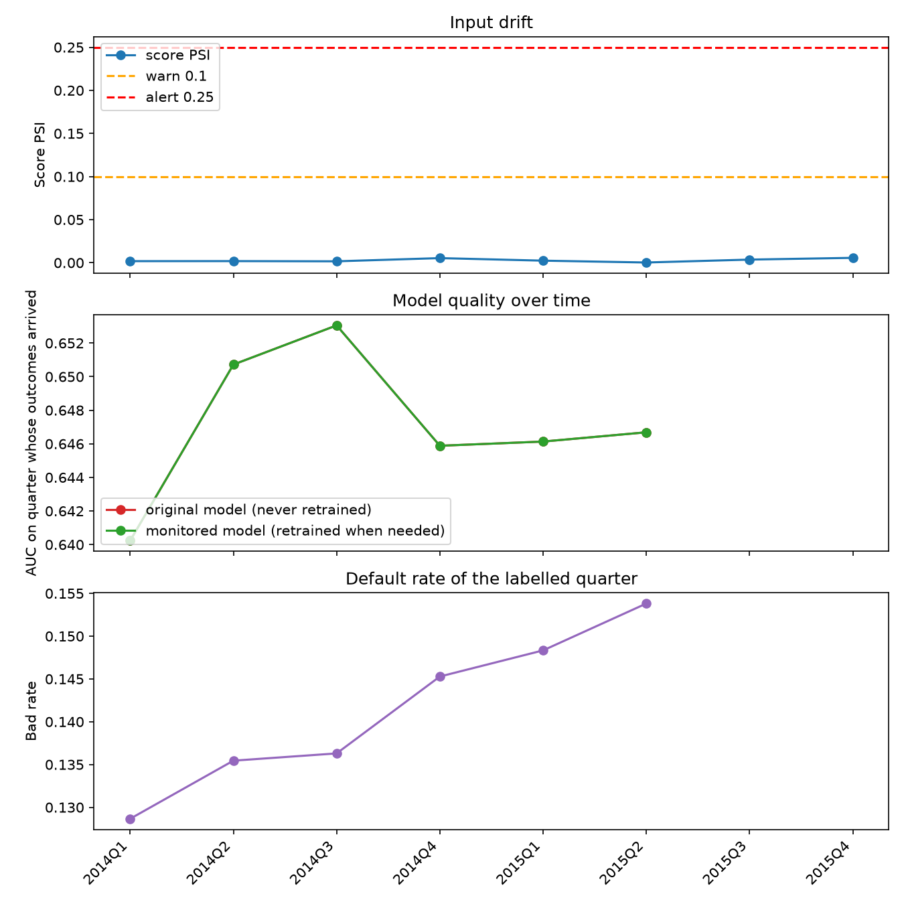
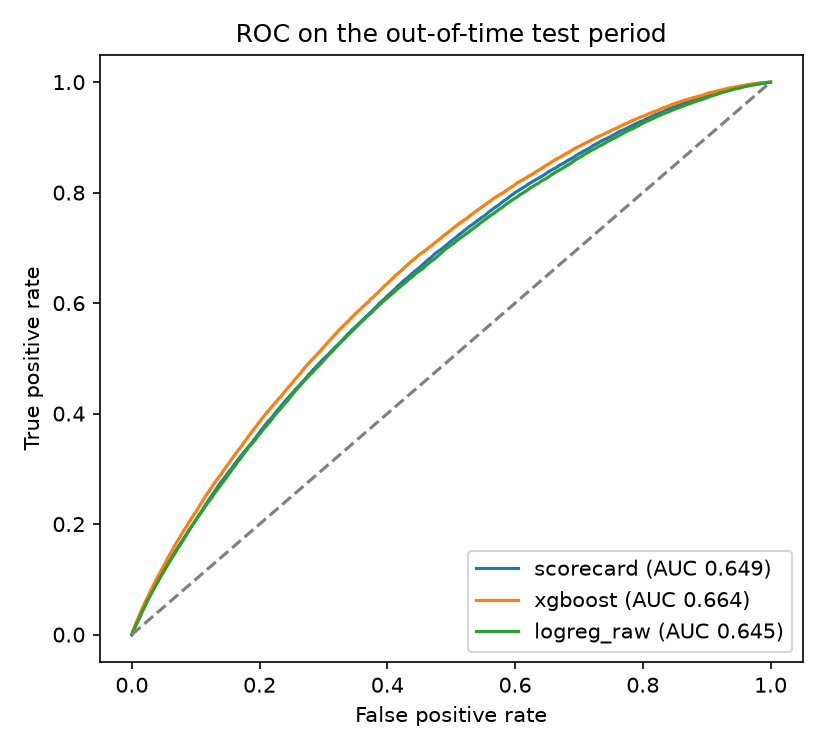

# Credit Risk MLOps Pipeline

A loan-default scoring pipeline that does what a lender or credit bureau's model team does around a model: build an explainable scorecard, serve it, watch it for drift, and retrain it when it gets worse.

Built on the public Lending Club loan data. **Learning and portfolio project: not for real lending decisions.**

## What it does

| Stage | What happens | Tools |
|---|---|---|
| Data preparation | Reads 2.2 million loan records, builds the target, features and a time-based split | pandas, **PySpark** |
| Modelling | WoE logistic-regression **scorecard** (champion) vs XGBoost (challenger) vs raw baseline | optbinning, scikit-learn, XGBoost |
| Tracking | Every run, metric and model version recorded; champion alias in the registry | MLflow |
| Serving | Score, decision and top reasons for an application, as an API | FastAPI, Docker |
| Monitoring | Replays later quarters: score PSI, per-feature CSI, AUC once outcomes arrive | own PSI/CSI code |
| Retraining | Challenger trained on recent labelled data, promoted only if clearly better | champion-challenger |
| Explanations | Optional plain-language rewrite of the reason codes (never makes the decision) | Gemini, Langfuse |
| Quality | Unit and end-to-end tests, CI on every push, auto-generated model card | pytest, GitHub Actions |
| Record matching | Separate PySpark exercise: finding duplicate customer records | PySpark |

## Why these design choices

- **Time-based split, never random.** Train on 2012-2013 loans, validate on 2014, test on 2015.
- **Only loans with a final outcome, 36-month term.** Later loans have not finished, so their bad rates are biased (the data shows 2018 "improving" only because bad loans take longer to show up).
- **Leakage control.** Grade, sub-grade and interest rate come from the lender's own model, and the instalment is calculated from the rate, so they are excluded.
- **Scorecard first.** Credit teams need to explain each score. XGBoost is kept as a challenger to show what accuracy the simple model gives up.
- **Wrong-way signs are removed.** A feature whose coefficient has the wrong sign is dropped and the model refitted.
- **Label delay is simulated.** A loan's outcome arrives quarters later, so drift is detected from inputs first (PSI), and performance is measured when labels arrive.
- **Promotion guard.** The challenger must beat the champion on held-out recent quarters by a margin.

## Results

Numbers are produced by the pipeline and written to `reports/` and `docs/MODEL_CARD.md`.
Paste your run's numbers here:

| Model | Train AUC | Validation AUC | Out-of-time test AUC | Test KS |
|---|---|---|---|---|
| Raw logistic regression | | | | |
| Scorecard (champion) | | | | |
| XGBoost (challenger) | | | | |




## Try it: the Loan Risk Check app

A plain-language demo for non-technical viewers. Pick an example applicant (or change the details) and see the risk, the decision, and the reasons in everyday words. A second tab shows whether the system is still working well, and a third explains how it works and what it cannot do.

```
streamlit run app.py
```

<!-- add screenshots: docs/app_check.png, docs/app_health.png -->

## Setup (Windows)

```
py -3.12 -m venv .venv
.venv\Scripts\activate
pip install -r requirements.txt
```

PySpark also needs Java 17 or 21:

```
winget install EclipseAdoptium.Temurin.21.JDK
```

Close and reopen the terminal afterwards, and check with `java -version`.

Download the Lending Club accepted-loans file from Kaggle (check the licence on the page) and put `accepted_2007_to_2018Q4.csv.gz` in `data/raw/`. The data is not committed to this repo.

## Run

Everything in one go:

```
python -m src.run_all --spark
```

Or step by step:

| Command | Does |
|---|---|
| `python -m src.spark_prepare` | PySpark data preparation (or `python -m src.day1_explore` then `python -m src.day2_prepare` for pandas) |
| `python -m src.train` | Trains the three models, saves `models/` and `reports/`, logs to MLflow |
| `python -m src.monitor` | Replays 2014-2015 quarter by quarter, monitors drift, retrains if needed |
| `python -m src.monitor --mode scheduled` | Also reviews a challenger every quarter |
| `python -m src.model_card` | Writes `docs/MODEL_CARD.md` |
| `mlflow ui --backend-store-uri sqlite:///mlflow.db` | Browse runs and the model registry (if MLflow had to use its file backend, use `mlflow ui --backend-store-uri ./mlruns` with `MLFLOW_ALLOW_FILE_STORE=true`) |
| `streamlit run app.py` | The plain-language demo app |
| `python -m src.record_matching` | PySpark record-matching exercise |
| `python -m pytest` | Runs the tests |

## Scoring API

```
uvicorn src.api:app --reload
```

Open http://127.0.0.1:8000/docs and try `POST /score`. Only `loan_amnt` and `annual_inc` are required. The response contains the default probability, a credit-style score, an approve or decline decision from the cost-based threshold, the top reasons, and a plain-language explanation.

With Docker (after training):

```
docker compose up --build
```

Optional LLM explanations: `pip install -r requirements-llm.txt`, then set `ENABLE_LLM_EXPLANATION=1` and `GEMINI_API_KEY`. The LLM only rewrites the reason codes. Its output is checked (no unexpected numbers, no personal characteristics, no promises) and the template text is used if the check fails.

## Record matching (PySpark)

Credit bureaus receive the same person from many lenders, with typos, different name order and missing fields. `src/record_matching.py` builds a fictional customer file, standardises it, compares only records that share a blocking key (so it never compares every pair), scores each candidate pair on name, date of birth, pincode and city, and reports precision, recall and the comparisons saved.

## Project structure

```
app.py                 plain-language demo app (Streamlit)
src/
  config.py            settings, paths, thresholds
  spark_prepare.py     PySpark data preparation
  day1_explore.py      pandas version of the first data step
  day2_prepare.py      pandas version of target, features and split
  models.py            scorecard, XGBoost challenger, baseline
  metrics.py           AUC, Gini, KS, calibration, PSI, CSI, threshold
  train.py             training, evaluation, reports, MLflow
  monitor.py           quarterly replay, drift checks, retrain trigger
  retrain.py           champion-challenger comparison
  registry.py          saving and loading models
  tracking.py          MLflow helpers
  api.py               FastAPI service
  scoring.py           scores one application (used by the API and the app)
  llm_explain.py       optional plain-language explanations
  model_card.py        writes the model card
  record_matching.py   PySpark duplicate-record matching
tests/                 unit and end-to-end tests
docker/                Dockerfile for the API
.github/workflows/     CI
```

## Limitations

- US peer-to-peer data, not Indian lending or bureau data. The methods carry over, the numbers do not.
- Production is simulated. Drift and label delay are replayed from history.
- Only 2012-2015 loans are used, because later loans have incomplete outcomes.
- The approval-cost ratio (5:1) is an assumption, and the approval threshold is not re-tuned when a retrained model is promoted.
- No fairness testing across groups was done. A real lender would need it.
- Record matching uses fictional data and hand-set weights.
